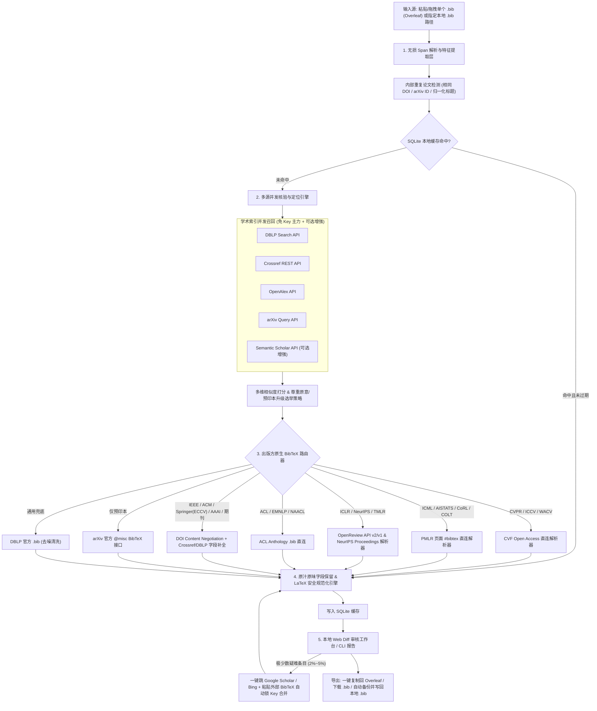

# `bibcanon` 软件需求与工程实现规范文档 (Software Specification)

> **文档定位**：本文档为 `bibcanon` 项目的最终定稿技术设计与可执行开发规范，供开发 Agent 独立、端到端地完成后端核验引擎、出版方适配器、CLI 工具与本地 Web 审核工作台的全部编码与测试交付。

---

## 1. 项目背景与核心目标

### 1.1 解决的核心痛点
在计算机视觉（CV）、人工智能（AI）与机器学习（ML）论文写作（使用 **Overleaf** 或 **本地 LaTeX**）及投稿阶段，作者维护单个 `.bib` 参考文献文件面临三大高频痛点：
1. **真伪与一致性核验困难**：难以快速排查 `.bib` 中的“大模型幻觉假论文”、标题与作者张冠李戴、年份错误、DOI 死链，或把仅挂在 arXiv 上的预印本错误写成已发表顶会（False Venue）。
2. **预印本转正繁琐（Preprint → Published）**：早期引用的 `arXiv` 论文后续已正式发表于 CVPR、ICCV、ECCV、ICML、NeurIPS、ICLR、AAAI、TPAMI 等顶会顶刊，人工逐篇检索替换耗时极长。
3. **获取出版方原汁原味官方 BibTeX 链路割裂**：从 Google Scholar 复制的 BibTeX 普遍存在会议名残缺、大小写错误、页码缺失、条目类型混乱；而去 Bing 搜索再逐个点进 CVF、IEEE、ACM、PMLR、Springer、AAAI、arXiv 官网复制或下载引用极其繁琐，且直接用爬虫抓取搜索引擎或商业出版商网页极易触发人机验证与 IP 封禁。

### 1.2 已敲定的产品决策（明确需求边界，严禁过度设计）
1. **输入输出聚焦单 `.bib` 全量检查**：用户的 `.bib` 文件通常仅存放当前论文的引用。仅需支持**单个 `.bib` 文件**的全量核验（Web 端支持粘贴 `.bib` 文本、拖拽上传 `.bib` 文件、或指定本地 `.bib` 文件路径；CLI 直接传入 `<file.bib>`）。**不需要**开发 `.tex` / `.bbl` / `.aux` / `.zip` 扫描过滤逻辑。
2. **启动形态聚焦标准终端 CLI**：用户习惯直接在终端使用 CLI 命令启动（如 `bibcanon serve` 启动本地 Web 工作台、`bibcanon check`、`bibcanon fix`），**不需要**编写额外的 `.bat` 启动脚本或桌面客户端外壳封装。
3. **默认「出版方原汁原味」字段策略**：在默认的 `canonical`（出版方标准模式）下，**忠实保留出版方提供的所有原始标准字段**（包括 `url`、`doi`、`month`、`publisher`、`organization`、`address`、`location`、`editor`、`volume`、`number`、`series`、`pages`、`articleno`、`numpages`、`pdf`、`isbn`、`issn` 等），仅剥离文献管理软件与聚合库的本地垃圾字段（如 `abstract`、`file`、`mendeley-tags`、`biburl`、`bibsource`、`timestamp`）。
4. **arXiv 预印本采用官网原生 `@misc` 格式**：对于尚未正式发表、仍处于 arXiv 阶段的论文，统一采用 arXiv 官网原生 `@misc` 格式（含 `eprint`、`archivePrefix = {arXiv}`、`primaryClass`、`url`）。
5. **同名会议版与后续期刊扩展版遵循「尊重原意」策略**：
   - 若原 `.bib` 条目**已明确写明某正式会议/期刊**（如 `CVPR`）且核验真实存在，**默认首推该会议对应的出版方官方 BibTeX**（如 CVF Open Access 版），将检索到的后续同名顶刊扩展版（如 `TPAMI`）列为备选标签供用户手动切换，绝不擅自跨体裁篡改；
   - **仅当原 `.bib` 条目为预印本（如 `arXiv` / `CoRR`）时**，才自动选举并默认推荐升级为最高规格的正式发表版本（正刊/正会 > Workshop > Preprint）。

### 1.3 核心设计不变量（Golden Invariants — 开发严禁违背）
1. **Citation Key 绝对锁死**：无论替换为何种出版方官方 BibTeX，输出条目的 Citation Key（如 `@inproceedings{he2016deep,` 中的 `he2016deep`）**必须 100% 保持原样**（除非用户在 UI 中显式手动修改），严禁破坏 `.tex` 正文中的 `\cite{...}` 引用关系。
2. **零配置开箱即用（Zero-Config First）**：默认完全依赖免注册、免付费的开放学术接口与开放出版平台直连即可完成全流程，无需配置任何 API Key 即可运行；礼貌池邮箱与免费增强 API Key 仅作为可选提速配置。
3. **无损文件级保护（Lossless File Patching）**：解析与导出 `.bib` 时，基于字符区间（Character Span）进行局部替换；用户未勾选修改的条目、`@string` 宏定义、`@preamble` 以及文件内的 `%` 注释必须原样保留。本地文件写回前必须自动生成带时间戳的备份文件（如 `references.bib.bak.20261117_200000`）。
4. **LaTeX 编译绝对安全**：生成的 BibTeX 必须经过严格的语法与字符清洗（如转义非 URL/DOI 字段中的裸 `&` 为 `\&`、页码统一为双连字符 `--`、剥离不可见控制字符、提供标题大小写保护开关），确保在 `pdflatex` / `xelatex` / `lualatex` + `bibtex` / `biber` 下零报错编译。
5. **跨平台与网络环境兼容（Windows 兼容）**：
   - 所有文件读写**必须显式指定 `encoding="utf-8"`**（严禁依赖 Windows 默认的 `gbk`/`cp936` 编码）。
   - 所有文件路径处理必须使用 `pathlib.Path`。
   - 所有 `httpx.AsyncClient` 实例必须开启 `trust_env=True` 与 `follow_redirects=True`（并支持在设置中可选指定 `proxy_url`）。

---

## 2. 系统总体架构与技术栈

### 2.1 系统流水线架构图



### 2.2 技术栈选型

| 层级 | 技术选型 | 说明与约束 |
| :--- | :--- | :--- |
| **后端语言与包管理** | Python `>=3.11`，标准 `pyproject.toml` | 兼容 `uv` 与标准 `pip install -e ".[dev]"` |
| **后端 Web 框架** | `FastAPI` + `uvicorn` | 提供 REST API 与 **SSE (Server-Sent Events)** 实时推送逐条扫描进度 |
| **HTTP 与并发控制** | `httpx` + `asyncio` | 按域名隔离并发信号量（`Semaphore`）与速率限制，内置指数退避重试 |
| **BibTeX 与 LaTeX 处理** | 自研无损 Span 切分器 + `bibtexparser>=1.4.1,<2.0` + `pylatexenc` | `bibtexparser` 固定使用稳定的 `1.4.x` API；`pylatexenc` 用于将 `{\"o}` 等转义还原为 Unicode 参与比对 |
| **HTML 解析与模糊匹配** | `beautifulsoup4` + `lxml` + `rapidfuzz` | 高性能静态页面提取与标题/作者相似度计算 |
| **数据校验与持久化** | `pydantic>=2.0` + Python 内置 `sqlite3` | 本地缓存与配置默认存放在 `~/.bibcanon/` 目录下 |
| **CLI 命令行** | `typer` + `rich` | 支持终端彩色进度条、体检汇总表、快速修复及启动本地 Web 服务（`bibcanon serve`） |
| **前端工作台** | `React 18` + `TypeScript` + `Vite` + `Tailwind CSS` + `lucide-react` | 构建产物输出至 `src/bibcanon/static/`，生产模式下由 FastAPI 单端口一体托管 |
| **测试框架** | `pytest` + `pytest-asyncio` + `respx`（Mock `httpx` 请求） | 核心解析、打分、路由与格式化逻辑必须具备完整的离线确定性单元测试 |

### 2.3 项目目录结构 (`bibcanon/`)

```text
bibcanon/
├── AGENTS.md                        # 开发 Agent 启动入口指南
├── SPEC.md                          # 本规范文档
├── README.md                        # 用户安装与 CLI / Web 使用说明
├── pyproject.toml                   # Python 包配置、依赖与 CLI 入口 (bibcanon = bibcanon.cli:app)
├── src/
│   └── bibcanon/
│       ├── __init__.py
│       ├── cli.py                   # Typer CLI 入口: serve, check, fix, cache
│       ├── config.py                # 配置加载与持久化 (~/.bibcanon/config.json)
│       ├── models.py                # Pydantic 核心数据结构与 API Schema
│       ├── server/
│       │   ├── app.py               # FastAPI 实例与静态前端托管
│       │   └── routes.py            # REST + SSE 路由实现
│       ├── core/
│       │   ├── bib_parser.py        # 无损 Span BibTeX 解析器与局部替换写出器
│       │   ├── normalizer.py        # 标题/作者/会议名归一化、LaTeX 转义解码、arXiv ID/DOI 提取
│       │   ├── dedup.py             # .bib 内部重复论文检测
│       │   ├── scorer.py            # 多维匹配打分、防幻觉熔断、尊重原意与预印本升级选举
│       │   ├── formatter.py         # 锁 Key 合并、原汁原味字段保留、可选大写保护与精简缩写渲染
│       │   ├── venue_dict.py        # CV/AI/ML 顶会顶刊同义词识别、全称 ↔ 标准缩写词典与专有名词表
│       │   └── pipeline.py          # 异步并发编排流水线（含 SSE 进度回调）
│       ├── providers/               # 第一阶段：学术索引发现与核验源
│       │   ├── base.py              # HttpClient 封装、域名级限流器、代理支持
│       │   ├── dblp.py              # DBLP Search API & .bib 下载
│       │   ├── crossref.py          # Crossref Works API & Polite Pool 支持
│       │   ├── openalex.py          # OpenAlex Works API
│       │   ├── arxiv.py             # arXiv API & 官网原生 @misc BibTeX 获取
│       │   └── semantic_scholar.py  # Semantic Scholar API (可选增强，优雅降级 429)
│       ├── adapters/                # 第二阶段：出版方原生 BibTeX 提取适配器
│       │   ├── router.py            # 出版方智能路由器
│       │   ├── cvf.py               # CVF Open Access (CVPR/ICCV/WACV) 适配器 + ToC 索引缓存
│       │   ├── pmlr.py              # PMLR (ICML/AISTATS/CoRL/COLT) 适配器
│       │   ├── openreview.py        # OpenReview API v2/v1 (ICLR/NeurIPS/TMLR) & NeurIPS 官网适配器
│       │   ├── acl.py               # ACL Anthology .bib 适配器
│       │   └── doi_negotiator.py    # DOI Content Negotiation + Crossref/DBLP 缺陷修复器
│       └── storage/
│           └── cache.py             # SQLite 缓存管理 (查询缓存 + CVF 会议目录缓存)
├── frontend/                        # 前端工程 (React + Vite + Tailwind CSS)
│   ├── package.json
│   ├── vite.config.ts               # 配置开发代理与构建输出至 ../src/bibcanon/static
│   └── src/
│       ├── App.tsx
│       ├── api/client.ts            # REST 请求与 SSE 订阅客户端
│       ├── types/index.ts           # 与后端严格对齐的 TypeScript 类型
│       └── components/
│           ├── TopToolbar.tsx       # 粘贴/上传/本地路径导入、筛选胶囊、模式开关、批量采纳、复制/写回
│           ├── EntryList.tsx        # 左侧引用列表与状态徽章
│           ├── DiffWorkbench.tsx    # 右侧元数据对比表 + BibTeX 左右分栏 Diff + 备选版本切换
│           ├── ManualAssistBar.tsx  # 一键跳 Scholar/Bing 搜索 + 粘贴外部 BibTeX 自动锁 Key 合并
│           └── SettingsModal.tsx    # 礼貌池邮箱、可选 API Key、可选本地代理、垃圾字段黑名单配置
└── tests/                           # 单元测试与端到端夹具
    ├── fixtures/                    # 示例 .bib 及各出版方真实 HTML/JSON 响应样本
    ├── test_parser_lossless.py
    ├── test_scorer_and_election.py
    ├── test_adapters.py
    └── test_formatter_latex_safety.py
```

---

## 3. 核心数据结构规范 (`models.py`)

### 3.1 核验状态枚举 (`VerificationStatus`)

| 枚举值 | UI 标签 | 触发条件定义 | 默认勾选行为 |
| :--- | :--- | :--- | :--- |
| `VERIFIED_CANONICAL` | `✅ 已核验·标准版` | 匹配总分 `>= 88`，已定位目标正式发表版本并成功获取出版方原生标准 BibTeX | 若与原条目有差异则默认推荐采纳（可被“一键采纳高置信度”选中） |
| `PREPRINT_UPGRADE` | `🔄 可转正升级` | 原条目为预印本（`arXiv` / `CoRR`），匹配总分 `>= 88`，且已找到正式发表的主会/期刊版本 | 默认推荐采纳升级（可被“一键采纳高置信度”选中） |
| `VERIFIED_PREPRINT_ONLY` | `📄 已核验·仅预印本` | 确认在 arXiv 真实存在（分数 `>= 88`），全网暂未检索到正式发表版本 | 可一键规范化为 arXiv 官网原生 `@misc` 格式 |
| `METADATA_MISMATCH` | `⚠️ 信息出入警告` | 存在疑似匹配（`65 <= 分数 < 88`），或虽标题极似但**作者不一致 / 年份偏差超阈值 / 原条目声称发表在某顶会但实际仅为未中稿预印本（False Venue） / 原条目声称在 A 会但实际发表在 B 会** | **严禁自动批量采纳**，必须人工审核确认 |
| `SUSPECTED_HALLUCINATION` | `❌ 疑似虚假/查无此文` | 最高候选分 `< 65`、或原条目填写的 DOI 经验证返回 404 死链且标题查无此文、或同标题论文作者完全无交集 | 标红警示，严禁自动替换 |
| `UNPROCESSED` / `ERROR` | `⏳ 待处理` / `⚡ 网络异常` | 尚未扫描，或所有上游数据源均发生网络故障/超时 | 保留原条目，支持单条重试 |

> **关键设计约束**：当本地断网或上游接口全部超时（HTTP 5xx / Timeout）时，状态必须标记为 `ERROR`（网络异常），**绝不能将网络失败误判为 `SUSPECTED_HALLUCINATION`**！

### 3.2 附加诊断警告标签 (`WarningCode`)
一条引用可同时挂载多个结构化警告：
- `DUPLICATE_IN_BIB`: 当前 `.bib` 文件内存在另一条指向同一篇论文的条目（附冲突的 `other_cite_keys`）。
- `INVALID_DOI`: 原条目包含的 `doi` 字段在 Crossref/`doi.org` 返回 404，或指向另一篇完全不同的论文。
- `INVALID_ARXIV_ID`: 原条目包含的 `arxiv_id` 不存在或标题完全不符。
- `FALSE_PUBLISHED_VENUE`: 原条目写的是正式会议/期刊（如 `CVPR`），但全网仅能查到其 `arXiv` 预印本或被拒稿记录，未查到该会议的正式录用记录。
- `VENUE_DIFFERS_FROM_ORIGINAL`: 原条目写的是正式会议 A（如 `CVPR`），但检索发现该论文实际仅正式发表在会议 B（如 `ICCV`）。
- `JOURNAL_EXTENSION_AVAILABLE`: 提示性信息（非错误）——原条目引用的是正式会议版（如 `CVPR 2022`），系统已默认匹配该会议官方版，同时检测到存在同名/近名后续期刊版（如 `TPAMI 2024`）已在候选栏就绪供按需切换。
- `AUTHOR_MISMATCH`: 标题高度匹配，但第一作者姓氏不匹配或作者列表重合度过低。
- `YEAR_DISCREPANCY`: 年份偏差超出正常出版周期范围。

### 3.3 单条核验结果对象 (`EntryAuditResult`)
- `cite_key: str` — 原始 Citation Key（只读锁死）
- `entry_index: int` — 在原文件中的顺序索引
- `span_start: int`, `span_end: int` — 在原 `.bib` 文本中的精确字符起止偏移
- `original_bibtex: str` — 原始 BibTeX 文本块
- `original_fields: dict[str, str]` — 解析后的原始字段字典（含 `ENTRYTYPE`）
- `status: VerificationStatus`
- `confidence: float` — `0.0 ~ 100.0`
- `warnings: list[AuditWarning]` — 包含 `code`、`severity` (`"error" | "warning" | "info"`) 与面向用户的中文说明 `message`
- `selected_candidate_idx: int | None` — 当前选中的推荐候选索引（默认 `0`）
- `candidates: list[CandidateRecord]` — 排序后的候选匹配列表（最多保留前 5 个供用户切换），每个 `CandidateRecord` 包含：
  - `source_discovery: str`（如 `"dblp"`, `"crossref"`, `"openalex"`, `"arxiv"`, `"manual"`）
  - `bibtex_origin: str`（如 `"CVF Open Access"`, `"PMLR Official"`, `"OpenReview Official"`, `"NeurIPS Proceedings"`, `"DOI Official (IEEE)"`, `"DOI Official (ACM)"`, `"DOI Official (Springer)"`, `"DOI Official (AAAI)"`, `"ACL Anthology"`, `"arXiv Official"`, `"DBLP Curated"`, `"Manual Paste"`）
  - `venue_tier: Literal["JOURNAL", "MAIN_CONF", "WORKSHOP", "PREPRINT"]`
  - `canonical_venue_id: str | None` — 归一化场馆标识（如 `"CVPR"`, `"ICML"`, `"TPAMI"`，用于比对原条目场馆意图）
  - `score: float` + `score_breakdown: dict[str, float]`（`title_score`, `author_score`, `year_score`）
  - `matched_title: str`, `matched_authors: list[str]`, `matched_year: int | None`, `matched_venue: str | None`, `doi: str | None`, `url: str | None`
  - `raw_publisher_fields: dict[str, str]` — 出版方原始提取字段（已剥离黑名单垃圾字段）
  - `canonical_bibtex: str` — 已锁死原 `cite_key` 的**出版方原汁原味标准版** BibTeX
  - `compact_bibtex: str` — 已锁死原 `cite_key` 的**会议缩写精简版** BibTeX（可选切换备用）
- `decision: Literal["accept", "keep_original", "custom"]` — 用户当前审核决策
- `custom_bibtex: str | None` — 用户在右侧编辑器手动微调或粘贴合并后的 BibTeX
- `search_links: dict[str, str]` — 预生成的半自动兜底搜索链接（`google_scholar`, `bing`, `dblp`, `semantic_scholar`）

---

## 4. 核心算法与业务逻辑细节

### 4.1 无损 `.bib` 解析与局部替换 (`bib_parser.py`)
1. **为什么不用全量重序列化**：直接将整个 `.bib` 解析后再全部重新序列化会丢失用户的分组注释（如 `% === Backbone Papers ===`）、`@string{cvpr = "Proc. CVPR"}` 宏以及未修改条目的缩进风格。
2. **实现方案**：
   - 编写状态机扫描器（跟踪花括号 `{}` 嵌套深度与引号 `""`，跳过以 `%` 开头的注释行及 `@comment`/`@string`/`@preamble` 块），精准定位每个标准条目 `@<type>{<cite_key>, ...}` 在原始字符串中的 `(span_start, span_end)`。
   - 对切分出的单个条目字符串调用 `bibtexparser.loads()` 提取字段。
   - **导出拼接算法**：遍历所有条目，若 `decision == "keep_original"`，直接截取原文件 `raw_text[span_start:span_end]`；若 `decision == "accept"`，填入当前选中候选在对应全局渲染开关下的 BibTeX；若 `decision == "custom"`，填入 `custom_bibtex`。条目之间的空白与注释段 `raw_text[prev_end:curr_start]` 原封不动拼接。

### 4.2 文本解码与特征提取 (`normalizer.py`)
1. **LaTeX 转义解码**：比对前使用 `pylatexenc.latex2text.LatexNodes2Text().latex_to_text()`（辅以正则清理残留 `{}`）将标题和作者姓名还原为纯 Unicode，再经 `unicodedata.normalize("NFKD", ...)` 处理变音符号（使得 `Sch{\"o}lkopf`、`Schölkopf` 与 `Scholkopf` 能够 100% 匹配）。
2. **标题归一化 (`normalize_title`)**：转小写 → 将连字符 `-`/`–`/`—` 替换为空格 → 移除除字母数字与空格外的所有标点 → 压缩连续空白。
3. **作者姓氏提取 (`extract_author_surnames`)**：
   - 按大小写不敏感的 `\band\b` 切分作者列表。
   - 兼容 BibTeX 两种标准姓名格式：含逗号 `"He, Kaiming"` 取第一个逗号前部分；无逗号 `"Kaiming He"` 取最后一个词（忽略 `Jr.`/`III` 等后缀）。
   - 过滤掉 `others`（即 `and others` 占位符），同时记录 `has_et_al = True`（当原条目含 `and others` 时，只考核已列出作者是否出现在官方作者列表中，不因官方作者总人数更多而扣分）。
4. **场馆意图识别 (`extract_canonical_venue`)**：
   - 利用 `venue_dict.py` 中的同义词正则映射表，识别原条目 `booktitle` / `journal` 所声称的规范化场馆 ID（例如 `"Proceedings of the IEEE/CVF Conference on Computer Vision and Pattern Recognition"`, `"CVPR"`, `"IEEE Conf. Comput. Vis. Pattern Recognit."` 均映射为 `"CVPR"`）。
5. **标识符与预印本特征提取**：
   - `arXiv ID` 提取正则：匹配 `\b(\d{4}\.\d{4,5})(?:v\d+)?\b` 或旧版 `\b([a-z\-]+(?:\.[A-Z]{2})?/\d{7})(?:v\d+)?\b`，扫描 `eprint` -> `journal` -> `booktitle` -> `note` -> `howpublished` -> `doi` (`10.48550/arXiv.xxx`) -> `url`。
   - `DOI` 提取正则：匹配 `10\.\d{4,9}/[-._;()/:A-Za-z0-9]+`（若以 `10.48550/arxiv.` 开头，归类为 `arXiv ID` 而非正式出版物 DOI）。
   - `is_preprint` 判定：当 `ENTRYTYPE == "misc"` 且含 arXiv 特征，或无 `booktitle`/`journal` 仅含 `eprint`，或 `journal`/`booktitle`/`howpublished` 含 `arxiv`、`corr`、`preprint`、`biorxiv`、`techreport`、`unpublished` 时，记为 `is_preprint = True`。

### 4.3 多维匹配打分与防幻觉熔断规则 (`scorer.py`)

对每个召回的候选记录计算综合置信度分数 `Score`（满分 `100`）：

1. **标题得分 `S_title`（0 ~ 100，权重 `0.55`）**：
   - `r_basic = rapidfuzz.fuzz.ratio(norm_orig_title, norm_cand_title)`，`r_sort = rapidfuzz.fuzz.token_sort_ratio(norm_orig_title, norm_cand_title)`，`S_title = 0.6 * r_basic + 0.4 * r_sort`。
   - **短标题保护**：若原归一化标题词数 `<= 4`，强制令 `S_title = r_basic`，且若 `r_basic < 92` 直接将总分上限锁死在 `60` 以下。
   - **副标题容错**：若原条目只写了主标题（词数 `>= 5`），且精确等于官方标题冒号前的部分、第一作者与年份吻合时，`S_title` 补偿至 `92`。

2. **作者得分 `S_author`（0 ~ 100，权重 `0.30`）**：
   - 第一作者姓氏相似度 `first_match = rapidfuzz.fuzz.ratio(orig_surnames[0], cand_surnames[0])`（`>= 85` 得 `100`，出现在前三位得 `60`，否则 `0`）。
   - 作者集合重合度 `overlap`（模糊匹配阈值 `85`；若 `has_et_al == True` 计算 Recall，否则计算 F1）。
   - `S_author = 0.5 * first_match + 0.5 * (overlap * 100)`。

3. **年份得分 `S_year`（0 ~ 100，权重 `0.15`）**：
   - 若原条目无年份：`S_year = 70`。
   - 若原条目 `is_preprint == True` 且候选为正式发表：当 `cand_year - orig_year` 在 `[-1, +3]` 之间时，`S_year = 100`。
   - 若原条目声称为正式发表：`|cand_year - orig_year| == 0` 得 `100`，`== 1` 得 `80`，`== 2` 得 `40`，`>= 3` 得 `0`。

4. **硬性防幻觉与张冠李戴熔断规则（Hard Guardrails）**：
   - **规则 A（张冠李戴熔断）**：若 `S_title >= 88`，但 `S_author < 35`，强制设为 `METADATA_MISMATCH`（若 `S_author == 0` 且标题非唯一则判为 `SUSPECTED_HALLUCINATION`），挂载 `AUTHOR_MISMATCH` 警告，**绝不允许判为 `VERIFIED`**。
   - **规则 B（假冒顶会熔断 / False Venue）**：若原条目 `is_preprint == False` 且填写了明确的会议/期刊（如 `booktitle = {CVPR}`），但全网检索到的所有匹配均为 `PREPRINT`（arXiv），状态必须设为 `METADATA_MISMATCH`，挂载 `FALSE_PUBLISHED_VENUE` 警告。
   - **规则 C（死链 DOI 熔断）**：若原条目自带正式 `doi`，经 Crossref / `doi.org` 查询确认返回 HTTP 404，挂载 `INVALID_DOI` 警告；若通过标题搜到了真论文，状态最高设为 `METADATA_MISMATCH`（需人工确认替换错误 DOI）；若标题也搜不到，判为 `SUSPECTED_HALLUCINATION`。

### 4.4 「尊重原意 + 预印本自动转正」候选排序算法 (`scorer.py`)

首先对所有候选正确划分场馆层级 `venue_tier`：
- DBLP 中 `venue == "CoRR"` 或 Crossref 中 `type == "posted-content"` 必须归入 `PREPRINT`。
- 会议名称中若包含以下任意词（大小写不敏感）：`workshop`, `workshops`, `cvprw`, `iccvw`, `eccvw`, `icmlw`, `neuripsw`, `companion`, `extended abstract`, `demo`, `doctoral consortium`, `tutorial`, `late-breaking`，必须归入 `WORKSHOP` 层级，绝不能归入 `MAIN_CONF`！

随后根据原条目类型执行**双分支排序选举**（决定 `candidates[0]` 默认首推项）：

1. **分支一：原条目已指定具体正式发表场馆（`orig.is_preprint == False` 且 `orig.canonical_venue_id` 非空，例如原 `.bib` 写的是 `CVPR`）**
   - **情况 1.1（原场馆匹配存在）**：在有效候选中找到了 `cand.canonical_venue_id == orig.canonical_venue_id` 的正式记录 ➔ **将该场馆候选排在 `candidates[0]` 作为默认首推项**，状态判为 `VERIFIED_CANONICAL`！若同时存在更高规格的后续同名期刊扩展版（如 `TPAMI`），将其排在 `candidates[1]`，并挂载一条 `info` 级别的 `JOURNAL_EXTENSION_AVAILABLE` 提示供用户按需手动切换。
   - **情况 1.2（原场馆不存在，但存在另一正式场馆）**：例如原 `.bib` 误写为 `CVPR 2023`，但实际该文仅发表在 `ICCV 2023` ➔ 将真实发表的 `ICCV 2023` 排在 `candidates[0]`，但状态设为 `METADATA_MISMATCH` 并挂载 `VENUE_DIFFERS_FROM_ORIGINAL` 警告，提醒用户核对会议名称差异。

2. **分支二：原条目为预印本（`orig.is_preprint == True`，如 `arXiv`）或未填写场馆**
   - 自动按最高学术出版规格选举 `candidates[0]`：
     `JOURNAL` / `MAIN_CONF`（优先标题相似度 `>= 95` 的正式版；同分时期刊优先于会议） > `WORKSHOP` > `PREPRINT`。
   - 若胜出者为 `JOURNAL` / `MAIN_CONF` / `WORKSHOP`，状态判为 `PREPRINT_UPGRADE`（可转正升级）；若仅存在 `PREPRINT`，状态判为 `VERIFIED_PREPRINT_ONLY`。

---

## 5. 外部数据源与出版方适配器接口规范

### 5.1 全局并发限流与礼貌请求策略 (`providers/base.py`)
所有 HTTP 请求统一携带清晰的 `User-Agent`：
`bibcanon/0.1.0 (Academic BibTeX Verifier; mailto:{configured_email_or_default})`

每个域名维护独立的 `asyncio.Semaphore` 与最小请求间隔令牌桶，遇到 HTTP `429` 或 `503` 时读取 `Retry-After` 头或执行指数退避（`1s -> 2s -> 4s`，最多重试 2 次）：

| 目标域名 / 服务 | 需要 API Key? | 默认最大并发数 | 速率上限控制 |
| :--- | :--- | :--- | :--- |
| `dblp.org` | 否 | 2 | `<= 2 req/s`（DBLP 对高频突发敏感，严格限速防 429） |
| `api.crossref.org` / `doi.org` | 否（支持邮箱 Polite Pool） | 3 | `<= 5 req/s` |
| `api.openalex.org` | 否（支持可选免费 Key） | 4 | 无 Key `<= 5 req/s`；有 Key `<= 15 req/s` |
| `export.arxiv.org` / `arxiv.org` | 否 | 1 | `<= 1 req/s`（arXiv 官方要求单连接间隔） |
| `openaccess.thecvf.com` | 否 | 3 | `<= 3 req/s`（配合本地会议目录缓存，请求极少） |
| `proceedings.mlr.press` | 否 | 3 | `<= 4 req/s` |
| `api2.openreview.net` / `api.openreview.net` | 否 | 2 | `<= 3 req/s` |
| `api.semanticscholar.org` | 可选（无 Key 时低优兜底） | 1 | `<= 1 req/s`（若遇 429 立即静默跳过，不阻塞主流程） |

### 5.2 第一阶段：四大主力发现源解析规范（及必防坑点）

1. **DBLP Search API (`providers/dblp.py`)**
   - 请求：`GET https://dblp.org/search/publ/api?q={urlencoded_title}&h=10&format=json`
   - **必防数据结构坑点（极其重要）**：
     - 当论文**只有 1 位作者**时，`info["authors"]["author"]` 是单个 **`dict`**；当有**多位作者**时才是 **`list[dict]`**！必须判断 `isinstance(..., dict)` 并包装为列表。
     - 同理，`info.get("ee")` 可能是单个 `str`，也可能是 `list[str]`（例如同时包含 `https://doi.org/...` 和 `https://openaccess.thecvf.com/...`）！必须统一转为 `list[str]`。
     - DBLP 同名作者末尾带有四位数字消歧编号（如 `"Yang Liu 0001"`），提取作者姓名和清洗 DBLP `.bib` 时**必须用正则 `\s+\d{4}$` 剥离该数字后缀**。

2. **Crossref REST API (`providers/crossref.py`)**
   - 按 DOI 查：`GET https://api.crossref.org/works/{urlencoded_doi}`
   - 按标题+第一作者查：`GET https://api.crossref.org/works?query.bibliographic={title}+{first_author}&rows=5`（配置邮箱时附加 `&mailto={email}`）
   - 提取 `title[0]`, `author`, `container-title[0]`, `published-print`/`published-online`, `DOI`, `type`, `page`, `article-number`, `volume`, `issue`, `publisher`。

3. **OpenAlex API (`providers/openalex.py`)**
   - 请求：`GET https://api.openalex.org/works?search={urlencoded_title}&per-page=5`。利用其 `locations` 数组发现预印本关联的正式版落地页 URL 与 DOI。

4. **arXiv API (`providers/arxiv.py`)**
   - 请求：`GET https://export.arxiv.org/api/query?id_list={arxiv_id}` 或 `search_query=ti:"{clean_title}"&max_results=5`，同时解析 `<arxiv:doi>` 与 `<arxiv:journal_ref>` 辅助发现已发表线索。

### 5.3 第二阶段：出版方原生 BibTeX 适配器路由规范 (`adapters/`)

锁定候选记录后，按以下优先级路由获取**原汁原味的出版方官方 BibTeX**：

#### 适配器 1：CVF Open Access (`adapters/cvf.py` — 针对 `CVPR` / `ICCV` / `WACV`)
- **定位机制**：
  1. 若候选 `ee_urls` 含有 `openaccess.thecvf.com/..._paper.html` 详情页链接，直接请求该详情页。
  2. 若无直达链接（如仅从 Crossref 拿到 IEEE DOI），查询本地 SQLite `cvf_toc_cache` 表；若该 `(venue, year)` 尚未缓存，请求 `https://openaccess.thecvf.com/{VENUE}{YEAR}?day=all`（兼容早期年份分日链接 `?day=...`），解析所有 `<dt class="ptitle"><a href="...">标题</a></dt>` 存入本地 SQLite，再按归一化标题查表定位详情页 URL。
- **提取方式**：在详情页 HTML 中依次尝试 `div.bibref`、`div[id^="bibtex"]` 或包含 `@InProceedings` 的 `<pre>` 节点，将 `<br>` 还原为换行，原样保留 CVF 给出的 `author`, `title`, `booktitle`, `month`, `year`, `pages` 字段。
- 标记来源：`bibtex_origin = "CVF Open Access"`。

#### 适配器 2：PMLR (`adapters/pmlr.py` — 针对 `ICML` / `AISTATS` / `CoRL` / `COLT` / `ACML`)
- **触发条件**：`ee_urls` 中包含 `proceedings.mlr.press` 或 `mlr.press`。
- **提取方式**：GET 该论文详情页 HTML（如 `https://proceedings.mlr.press/v235/xxx24a.html`），解析 `#bibtex` 节点内的官方 `@InProceedings{...}`（完整保留 PMLR 原生的 `editor`, `volume`, `series`, `pages`, `month`, `publisher`, `pdf`, `url` 等全部字段）。
- 标记来源：`bibtex_origin = "PMLR Official"`。

#### 适配器 3：OpenReview & NeurIPS Proceedings (`adapters/openreview.py` — 针对 `ICLR` / `NeurIPS` / `TMLR`)
- **分支 A（NeurIPS 官方论文集）**：若 `ee_urls` 匹配 `papers.nips.cc` 或 `proceedings.neurips.cc` 详情页，提取页面中指向 `.bib` / `Bibtex` 的下载链接获取官方 BibTeX（完整保留 `editor`, `volume`, `publisher`, `pages`, `url` 等原生字段）。标记来源：`"NeurIPS Proceedings"`。
- **分支 B（OpenReview API）**：若 `ee_urls` 包含 `openreview.net/forum?id={note_id}`，先请求 `GET https://api2.openreview.net/notes?id={note_id}`（校验 `venue.value` 排除 `Submitted`/`Rejected`/`Withdrawn`），读取 `content["_bibtex"]["value"]`；若为空则自动回退 API v1 `GET https://api.openreview.net/notes?id={note_id}` 读取 `content["_bibtex"]`。标记来源：`"OpenReview Official"`。

#### 适配器 4：ACL Anthology (`adapters/acl.py` — 针对 `ACL` / `EMNLP` / `NAACL` / `EACL` / `TACL`)
- **触发条件**：`ee_urls` 或 DOI (`10.18653/v1/{id}`) 指向 `aclanthology.org/{id}`。
- **提取方式**：直接请求 `GET https://aclanthology.org/{id}.bib`（完整保留 ACL 官方字段如 `editor`, `month`, `address`, `publisher`, `url`, `doi`, `pages`）。标记来源：`"ACL Anthology"`。

#### 适配器 5：DOI 官方注册协商 + 出版商结构修复器 (`adapters/doi_negotiator.py` — 针对 `IEEE` / `ACM` / `Springer(ECCV/IJCV)` / `AAAI` / `Elsevier` / `Nature` 等)
- **触发条件**：候选记录拥有正式出版物 DOI（如 IEEE `10.1109/...`、ACM `10.1145/...`、Springer `10.1007/...`、AAAI `10.1609/...`），且未命中上述开放静态直连源。
- **提取与修复流程（解决 Crossref 自动转换的已知缺陷）**：
  1. 向 `https://doi.org/{urlencoded_doi}` 发送 `GET` 请求，Header 设置 `Accept: application/x-bibtex; charset=utf-8`。
  2. **保留出版商提供的全部有效字段**（包括 `doi`, `url`, `month`, `publisher`, `address`, `location`, `series`, `volume`, `number`, `pages`, `articleno`, `numpages`, `isbn`, `issn`, `editor`），同时结合 Crossref JSON 与同篇 DBLP 记录执行以下**精准缺陷修复**：
     - **Springer LNCS（如 ECCV / MICCAI，`10.1007/978-...`）条目类型修复**：Crossref 默认会将 Springer 会议论文集章节映射为 `@inbook`！若检测到为会议论文（DBLP 类型为 `Conference and Workshop Papers` 或 `booktitle`/`series` 含会议/LNCS 特征），必须将 `@inbook` / `@incollection` 修正为 `@inproceedings`，确保会议名位于 `booktitle` 字段。
     - **页码与文章号补全**：若 `doi.org` 返回的 BibTeX 漏掉了 `pages`，优先用 Crossref JSON 的 `page` 字段补全；若无 `page` 但有 `article-number`（IEEE / ACM 常见），填入 `articleno`（或 `pages`）；若 Crossref 仍无页码但同篇 DBLP 记录含有 `pages`，用 DBLP 的 `pages` 补全。
     - **HTML 实体与 URL 清理**：解码残留的 `&amp;` ➔ `\&`；将过时的 `http://dx.doi.org/...` 规范化或解码其中的百分号编码。
- 标记来源：按 DOI 前缀标注 `"DOI Official (IEEE)"`、`"DOI Official (ACM)"`、`"DOI Official (Springer)"`、`"DOI Official (AAAI)"` 等。

#### 适配器 6：arXiv 官网原生 `@misc` 接口 (`providers/arxiv.py` — 针对 `VERIFIED_PREPRINT_ONLY`)
- 直接请求 `GET https://arxiv.org/bibtex/{arxiv_id}`，获取并原样保留 arXiv 官网原生 `@misc` 格式（包含 `title`, `author`, `year`, `eprint`, `archivePrefix = {arXiv}`, `primaryClass`, `url`）。
- 标记来源：`bibtex_origin = "arXiv Official"`。

#### 适配器 7：DBLP 官方 `.bib` 清洗兜底 (`providers/dblp.py`)
- 当目标论文既不在开放直连源中，也没有可用 DOI（如部分早年 IJCAI、BMVC 论文），请求 `GET https://dblp.org/rec/{dblp_key}.bib?param=1`。
- 剥离 DBLP 内部噪音字段（`biburl`, `bibsource`, `timestamp`）、作者四位消歧号以及标题末尾多余的句号 `.`。
- 标记来源：`bibtex_origin = "DBLP Curated"`。

---

## 6. 字段保留策略、LaTeX 安全清洗与可选格式模式 (`formatter.py`)

### 6.1 默认「出版方原汁原味」字段策略 (`canonical` 模式 — 默认)
1. **锁死 Citation Key**：强制将输出条目的 Key 替换为 `original.cite_key`，保持条目原始推荐类型（如 `@inproceedings`、`@article`、`@misc`）。
2. **仅剔除本地垃圾字段（黑名单机制，绝不误删出版方字段）**：
   - 默认仅剥离以下非出版方标准字段：`abstract`, `file`, `local-url`, `mendeley-tags`, `zotero-key`, `annote`, `biburl`, `bibsource`, `timestamp`。
   - **完整保留**出版方给出的所有其他字段（包括但不限于 `author`, `title`, `booktitle`, `journal`, `editor`, `volume`, `number`, `series`, `pages`, `articleno`, `numpages`, `year`, `month`, `publisher`, `organization`, `address`, `location`, `doi`, `url`, `pdf`, `eprint`, `archivePrefix`, `primaryClass`, `isbn`, `issn`, `note`）。
3. **LaTeX 编译安全最小必要清洗**：
   - 页码范围规范化：将 `pages` 中的单连字符 `-`（数字区间时）、Unicode 短破折号 `–` (`\u2013`)、长破折号 `—` (`\u2014`) 统一规范化为 LaTeX 标准双连字符 `--`（如 `"123-132"` / `"123–132"` ➔ `"123--132"`）。
   - 裸特殊字符转义：在非原始链接字段（即排除 `url`、`doi`、`pdf`、`eprint` 字段，且跳过 `$...$` 数学模式内部）中，将未转义的裸 `&` 替换为 `\&`，裸 `%` 替换为 `\%`。
   - 将不间断空格 `\u00a0` 替换为普通空格，剥离不可见 ASCII 控制字符。

### 6.2 可选增强开关（在 Web 顶部工具栏与 CLI 参数中提供）
1. **标题专有名词大小写幂等保护开关 (`protect_title_case: bool`，默认开启或可在工具栏一键实时切换)**：
   - 识别并花括号包裹标题中的全大写缩写/数字前缀词（`{3D}`, `{RGB-D}`, `{LLMs}`, `{CNN}`, `{SLAM}`）、驼峰模型名（`{ResNet}`, `{ViT}`, `{NeRF}`, `{PyTorch}`, `{DeepLab}`, `{LoRA}`）及 CV/AI 专有名词词表（`{Gaussian}`, `{Bayesian}`, `{Markov}`, `{Fourier}`, `{Transformer}` 等），防止老旧 `.bst` 样式将其强制编译为小写。
   - **严格保证幂等**：若原词已被 `{...}` 包裹或整个标题已有双层花括号 `{{...}}`，绝不二次包裹为 `{{3D}}`。关闭该开关时保持出版方原始标题花括号状态不变。
2. **备用「会议投稿省页码缩写模式」(`compact` 模式 — 可选切换)**：
   - 平时默认使用 `canonical` 原汁原味模式；当用户在特定顶会投稿遇到严格参考文献页数限制时，可在顶部一键切换至 `compact` 模式：使用 `venue_dict.py` 内置的 35+ CV/AI/ML 顶会顶刊权威缩写表（`CVPR`, `ICCV`, `ECCV`, `ICML`, `NeurIPS`, `ICLR`, `AAAI`, `IJCAI`, `ACL`, `IEEE TPAMI`, `IJCV`, `JMLR` 等）替换长全称，并精简 `url`/`doi`/`month`/`publisher`/`organization`/`address`/`editor`/`series`/`isbn`/`issn`。

---

## 7. API 接口、Web 审核工作台与 CLI 规范

### 7.1 后端 REST & SSE 接口清单 (`server/routes.py`)

默认监听地址：`http://127.0.0.1:8765`

| 方法与路径 | 用途 | 请求体 / 参数 | 响应说明 |
| :--- | :--- | :--- | :--- |
| `POST /api/jobs` | 创建 `.bib` 扫描核验任务 | `{ "bib_content"?: string, "bib_path"?: string, "force_refresh": boolean }` | 无损解析单个 `.bib`，立即返回 `{ "job_id": str, "total_entries": int, "entries": EntryAuditResult[] }`（初始状态为 `UNPROCESSED`） |
| `GET /api/jobs/{job_id}/stream` | **SSE 实时进度流** | 路径参数 `job_id` | 每完成一条引用的核验与出版方抓取，立即推送 `event: entry_updated`（含完整 `EntryAuditResult` 与当前进度 `completed/total`）；全部完成后执行全局去重交叉标记并推送 `event: job_completed` |
| `POST /api/jobs/{job_id}/cancel` | 中止正在运行的任务 | 路径参数 `job_id` | 取消后台异步任务，保留已完成条目的结果 |
| `POST /api/jobs/{job_id}/entries/{cite_key}/retry` | 单条重新检索 | `{ "override_query_title"?: string, "force_refresh": true }` | 允许用户微调搜索标题或强制绕过缓存单条重查 |
| `POST /api/jobs/{job_id}/entries/{cite_key}/paste-merge` | **手动粘贴外部 BibTeX 智能合并** | `{ "pasted_bibtex": string }` | 解析用户从 Google Scholar / 官网粘入的任意 BibTeX，**强制替换为原 `cite_key`**，运行黑名单垃圾字段剔除与安全转义管线，作为新候选插入并自动选中为采纳状态 |
| `POST /api/export/render` | 实时渲染最终 `.bib` 全文 | `{ "job_id": string, "style_mode": "canonical" \| "compact", "protect_title_case": boolean, "decisions": Record<cite_key, DecisionPayload> }` | 基于原文件字符 Span 无损拼接并返回 `{ "output_bibtex": string, "stats": ExportStats }` |
| `POST /api/export/write-local` | 安全写回本地 `.bib` 文件 | 同上 + `{ "target_bib_path": string }` | 先将原文件备份为 `<filename>.bak.<YYYYMMDD_HHMMSS>`，再以 UTF-8 写入新内容，返回备份路径 |
| `GET / PUT /api/settings` | 读取 / 保存全局设置 | `AppConfig`（礼貌池邮箱、可选 OpenAlex/S2 Key、可选 `proxy_url`、垃圾字段黑名单） | 持久化至 `~/.bibcanon/config.json` |
| `DELETE /api/cache` | 清空本地缓存 | `?scope=all` 或 `?scope=queries` | 清理 SQLite 缓存并返回释放条数 |

### 7.2 Web 工作台界面与交互设计规范 (`frontend/`)

1. **顶部工作栏 (`TopToolbar.tsx`)**：
   - **极简 `.bib` 导入**：支持直接粘贴 Overleaf `.bib` 全文、拖拽上传 `.bib` 文件、或输入本地 `.bib` 文件绝对路径一键开始扫描。
   - **状态筛选胶囊（带实时计数）**：`全部` | `❌ 疑似虚假` | `⚠️ 信息出入` | `🔄 可转正升级` | `✅ 已核验可更新` | `✅ 已一致` | `🔁 重复条目`。
   - **渲染模式开关**：默认选中 `[出版方原汁原味版]`（可按需切至 `[省页码缩写版]`），旁附 `[标题大写保护 {3D}/{ViT}]` 勾选开关（切换即时刷新右侧预览与导出结果，无需重新联网请求）。
   - **批处理与导出**：`✨ 一键采纳高置信度更新`、`📋 一键复制完整 .bib`（粘回 Overleaf）、`💾 下载 .bib`、`💾 备份并覆盖本地文件`（本地路径导入时可用）。

2. **主工作区（左列表 32% + 右侧 Diff 审核台 68%）**：
   - **左侧条目列表 (`EntryList.tsx`)**：支持搜索过滤与键盘上下键快速切换；每行展示 `cite_key`、标题、状态徽章、出版方来源徽章（如 `CVF`、`PMLR`、`IEEE DOI`、`arXiv`）及采纳勾选框。
   - **右侧详情与 Diff 审核台 (`DiffWorkbench.tsx`)**：
     - **诊断提示栏**：展示匹配置信度分与结构化警告/提示（如 `🔄 原条目为 arXiv 2023，已匹配 CVPR 2024 正式版`、或 `ℹ️ 已默认保留 CVPR 官方版，另检测到后续 TPAMI 期刊版可点击上方标签切换`、或 `⚠️ 作者不匹配警告`）。
     - **多候选版本标签栏**：展示 `candidates` 列表（标注来源与年份场馆），支持一键点击切换采用的版本。
     - **元数据字段级对比表**：直观高亮对比 `Title`、`Authors`、`Venue`、`Year`、`Pages`、`DOI` 的原值与新值。
     - **BibTeX 源码左右分栏 Diff 视图**：左侧原 `.bib` 块，右侧即将导出的新 `.bib` 块（高亮增删改行），右侧支持点击“手动微调”直接编辑文本。
     - **底部半自动兜底辅助栏 (`ManualAssistBar.tsx`)**：内置 4 个一键外跳搜索按钮（`🔍 Google Scholar`、`🔍 Bing 搜索`、`🔍 DBLP`、`🔍 Semantic Scholar`，点击自动带纯标题在新标签页打开）+ **「粘贴外部 BibTeX 自动锁 Key 合并」** 输入框。

### 7.3 CLI 命令行规范 (`cli.py`)

用户在终端通过以下 4 个子命令操作：
1. `bibcanon serve [bib_file] [--port 8765] [--no-browser]`：启动本地 FastAPI + Web 工作台并在默认浏览器打开（若传入了可选参数 `bib_file`，打开页面后自动加载该本地 `.bib` 文件）。
2. `bibcanon check <bib_file> [--json <report.json>]`：终端显示 `rich` 并发进度条，输出彩色汇总体检表（列出虚假引用、信息出入、重复条目及可转正预印本）；若存在 `SUSPECTED_HALLUCINATION` 则返回非零退出码 `1`。
3. `bibcanon fix <bib_file> [-o <output.bib> | --in-place] [--mode canonical|compact] [--min-confidence 90]`：自动替换所有高置信度无警告条目（`--in-place` 自动生成 `.bak` 备份），保留存疑条目不变并打印需人工复核的 `cite_key` 清单。
4. `bibcanon cache [stats|clear]`：查看或清理本地 SQLite 缓存。

---

## 8. 开发 Agent 分阶段执行路线图与验收标准

请开发 Agent 严格按以下 **5 个阶段（Phases）** 顺序推进，**每完成一个阶段必须运行对应的验证测试并通过后，再进入下一阶段**。

### Phase 1：工程骨架、无损 Span 解析器与原汁原味格式化引擎
- **交付内容**：
  1. 初始化 `pyproject.toml`、包结构与 `pytest` 测试环境。
  2. 实现 `models.py`、`config.py`、`bib_parser.py`（无损字符 Span 解析与局部替换写出）、`normalizer.py`、`dedup.py`、`venue_dict.py`、`formatter.py`。
- **Phase 1 验收标准（单元测试必测项）**：
  - [ ] 包含文件头注释、条目间 `%` 注释、`@string` 宏的 `.bib` 文件，仅替换中间某条引用时，其余所有字节 100% 原样保留，且被替换条目的 `cite_key` 严格不变。
  - [ ] 验证 `canonical` 模式下完整保留出版方特有的 `url`、`month`、`publisher`、`organization`、`editor`、`articleno`、`numpages`、`pdf`、`isbn` 等全部字段，同时精准剔除 `abstract`、`file`、`mendeley-tags`、`biburl`、`bibsource`、`timestamp`。
  - [ ] 验证非 URL/DOI 字段中的裸 `&` 转义为 `\&`（而 `url` 中的 `&` 不被破坏），页码 `"105-114"` 与 `"105–114"` 规范化为 `"105--114"`，标题大小写保护 `{3D}`/`{ResNet}` 严格幂等。
  - [ ] Windows 下含 `Sch{\"o}lkopf` 与 UTF-8 重音字符 `Schölkopf` 的 `.bib` 读写与作者归一化比对 100% 相等。

### Phase 2：SQLite 缓存层、限流 HTTP 客户端、四大发现源与选举算分器
- **交付内容**：
  1. 实现 `storage/cache.py`（SQLite 表：`query_cache`、`cvf_toc_cache`，默认 30 天 TTL）。
  2. 实现 `providers/base.py`（域名级 `Semaphore` + 速率控制 + `trust_env=True` + 可选 `proxy_url` + 指数退避重试）。
  3. 实现 `providers/dblp.py`、`crossref.py`、`openalex.py`、`arxiv.py` 及可选 `semantic_scholar.py`。
  4. 实现 `core/scorer.py`（多维打分、三大防幻觉熔断规则、「尊重原意 + 预印本自动转正」双分支选举算法）。
- **Phase 2 验收标准（基于 `respx` Mock 确定性测试）**：
  - [ ] DBLP 单作者（`dict`）与多作者（`list`）、单 `ee` 与多 `ee`、姓名带 `0001` 消歧后缀的响应均能正确解析。
  - [ ] **尊重原意测试**：当原 `.bib` 已写明 `booktitle = {CVPR}`，同时召回 `CVPR 2022` 正会记录与同名 `TPAMI 2024` 期刊记录时，`candidates[0]` 必须选中 `CVPR 2022`（`TPAMI 2024` 排在 `candidates[1]` 并附 `JOURNAL_EXTENSION_AVAILABLE` 提示）；而当原 `.bib` 为 `arXiv` 预印本时，`candidates[0]` 自动升级为最高规格正式版（且过滤排除 `CVPRW` Workshop 与 `CoRR`）。
  - [ ] **防幻觉与张冠李戴测试**：编造标题判 `SUSPECTED_HALLUCINATION`；真实标题但篡改作者触发熔断挂 `AUTHOR_MISMATCH`；仅在 arXiv 的论文谎称 `ICCV` 判 `METADATA_MISMATCH` 并挂 `FALSE_PUBLISHED_VENUE`；上游全部超时判 `ERROR` 而非幻觉。

### Phase 3：出版方原生 BibTeX 路由器与各顶会适配器
- **交付内容**：
  1. 实现 `adapters/cvf.py`（含详情页提取与 `{VENUE}{YEAR}?day=all` 目录本地 SQLite 缓存）、`pmlr.py`、`openreview.py`（兼容 API v2/v1 与 NeurIPS 论文集页面）、`acl.py`、`doi_negotiator.py`（含 Springer LNCS `@inbook` -> `@inproceedings` 修复、页码/`articleno` 补全、HTML 实体解码）。
  2. 实现 `adapters/router.py` 与 `core/pipeline.py` 异步并发编排。
- **Phase 3 验收标准**：
  - [ ] 针对 CVPR（CVF）、ICML（PMLR）、ICLR（OpenReview）、NeurIPS（NeurIPS Proceedings）、ACL（ACL Anthology）、IEEE TPAMI（DOI）、ACM MM（DOI 含 `articleno`/`numpages`）、ECCV（Springer LNCS DOI 修正 `@inbook` 为 `@inproceedings`）、AAAI（DOI）、纯 arXiv 预印本（官网原生 `@misc` 含 `eprint`/`archivePrefix`/`primaryClass`）十类样本完成测试验证，确保锁死原 `cite_key` 且字段原汁原味。

### Phase 4：CLI 命令行与 FastAPI + SSE 服务端
- **交付内容**：
  1. 实现 `server/app.py` 与 `server/routes.py` 全部 REST + SSE 接口（含 `paste-merge` 合并与本地 `.bak` 备份写回）。
  2. 实现 `cli.py`（`serve [bib_file]`, `check`, `fix`, `cache` 四个子命令）。
- **Phase 4 验收标准**：
  - [ ] 通过 `FastAPI TestClient` 验证创建任务、SSE 流式返回、`paste-merge` 外部粘贴锁 Key 合并、无损渲染导出与本地 `.bak` 备份写回全链路闭环通过。
  - [ ] 验证终端 CLI 子命令 `bibcanon check` 与 `bibcanon fix` 正常执行并输出规范表格。

### Phase 5：React + Vite 本地 Web 审核工作台与一体打包交付
- **交付内容**：
  1. 完成 `frontend/` 全部界面开发（极简 `.bib` 粘贴/上传/本地路径导入栏、筛选胶囊、原汁原味版/精简版及大写保护实时开关、左列表键盘导航、右侧元数据对比表 + BibTeX 左右分栏 Diff + 候选版本标签切换、Scholar/Bing 一键搜索与粘贴外部 BibTeX 合并框、设置弹窗）。
  2. 执行构建将前端静态产物输出至 `src/bibcanon/static/`，确保运行 `bibcanon serve` 单命令即可打开完整 Web 工作台。
  3. 编写清晰的 `README.md`（安装方法、终端 `bibcanon serve` / `check` / `fix` 用法、Overleaf 与本地 `.bib` 使用流程）。
- **Phase 5 最终端到端验收标准**：
  - [ ] `pytest` 全量单元测试与集成测试 100% 通过。
  - [ ] 前端 `tsc --noEmit` 与 `vite build` 零报错完成构建。
  - [ ] 启动 `bibcanon serve` 后访问 `http://127.0.0.1:8765`，导入包含混合真实顶会、arXiv 待转正、纯 arXiv 预印本、同名会议+期刊双版本、重复条目与幻觉条目的综合测试 `.bib` 文件，全流程交互、实时进度、Diff 预览与一键复制/导出工作正常。
